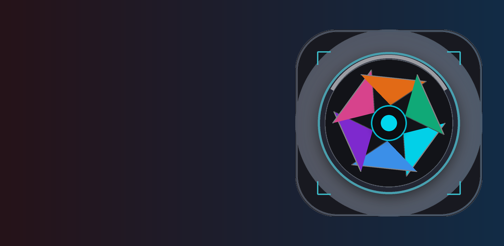
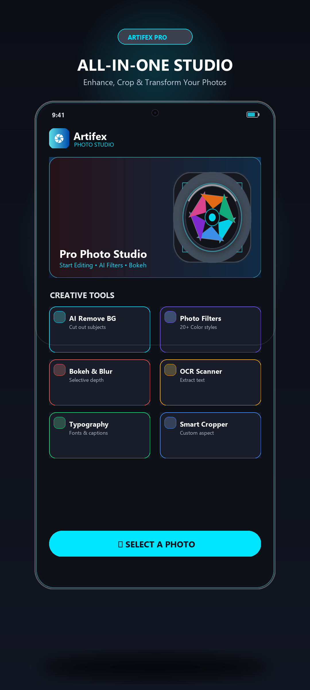
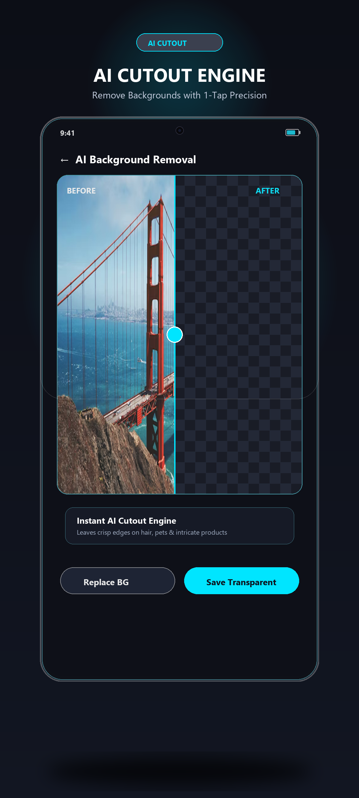
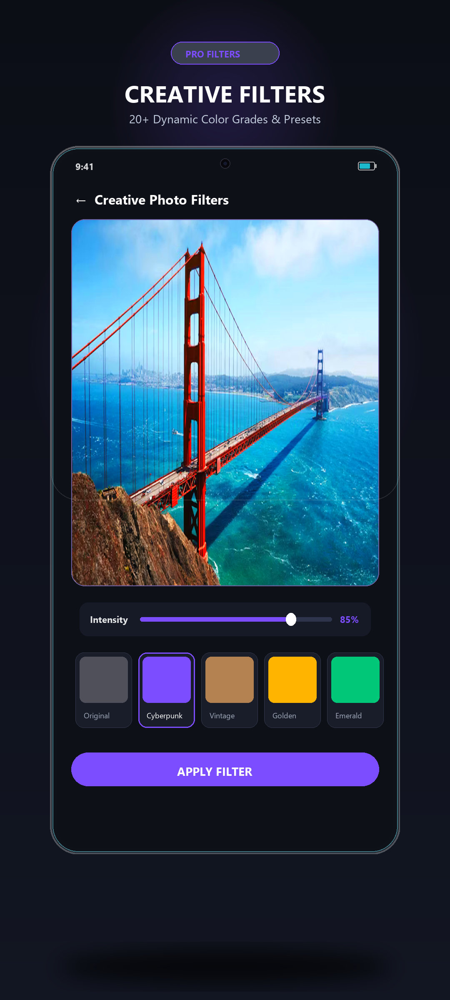
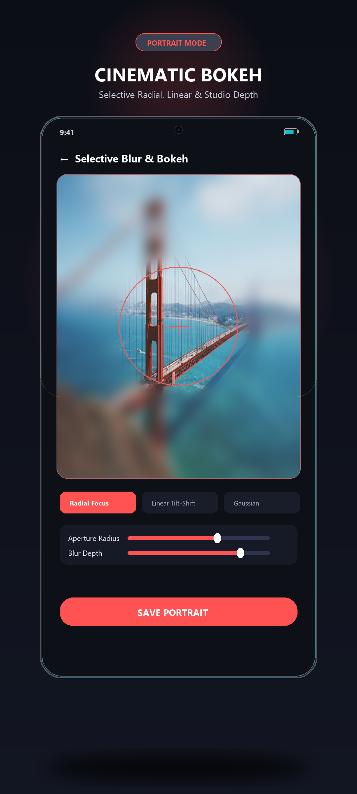
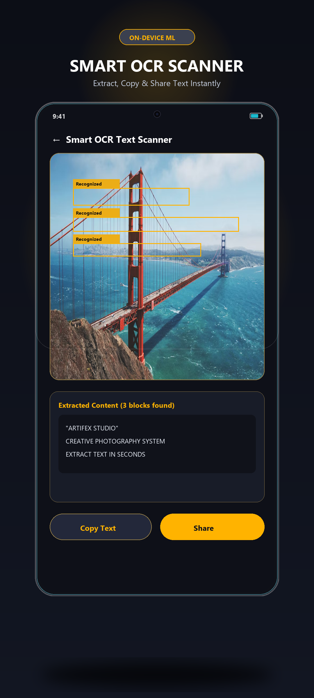
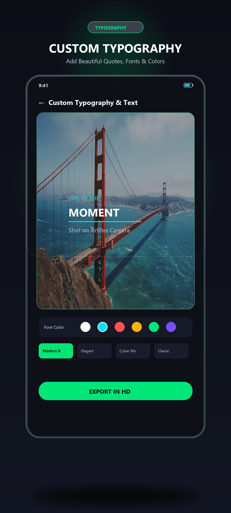

<div align="center">

# 📸 Artifex Photo Editor

### *Professional On-Device Photo Studio & AI Creative Suite*

<p align="center">
  
</p>

[](https://flutter.dev)
[](https://dart.dev)
[](https://developer.android.com)
[](pubspec.yaml)
[](https://play.google.com/store/apps/details?id=com.artifex.ai)
[](https://opensource.org/licenses/MIT)

<p align="center">
  <a href="https://play.google.com/store/apps/details?id=com.artifex.ai">
    
  </a>
</p>

</div>

---

## 📖 Overview

**Artifex Photo Editor** is a feature-complete, production-grade mobile photo studio built with **Flutter**. Engineered with high-performance on-device image processing algorithms, dynamic hardware-accelerated color matrices, intelligent AI subject cutouts, lens bokeh depth rendering, and offline machine learning text recognition via Google ML Kit.

Designed for privacy-first, zero-latency workflows with 100% compliance with modern **Google Play Store policies (`targetSdk 36`)**.

---

## 📱 App Showcase

<div align="center">

| 1. All-in-One Studio | 2. AI Cutout Engine | 3. Creative Filters |
| :---: | :---: | :---: |
|  |  |  |
| *Full Canvas & Multi-Layer Editing* | *Instant 1-Tap Subject Cutout* | *20+ Dynamic Color Presets* |

| 4. Cinematic Bokeh | 5. Smart OCR Scanner | 6. Custom Typography |
| :---: | :---: | :---: |
|  |  |  |
| *Radial & Linear Tilt-Shift Focus* | *On-Device Google ML Kit Text OCR* | *Aesthetic Fonts, Colors & Quotes* |

</div>

---

## ✨ Key Features

### 🎨 1. Pro Creative Studio (All-in-One Canvas)
- **Multi-Layer Interactive Editing**: Combine cropping, live color matrix filters, text overlays, and Gaussian blur on a single interactive canvas.
- **Precision Image Cropping**: Aspect-ratio control (1:1, 4:5, 16:9, 9:16), freeform cropping, and rotational angles powered by native `UCropActivity`.
- **Lossless Gallery Export**: Direct-to-gallery image saving with full runtime permission compliance via `gal`.

### 🪄 2. AI Background Removal
- **Precision Cutout Engine**: Intelligent subject and boundary separation for complex edges (hair, pets, detailed product shots).
- **Instant PNG Export**: Save transparent PNG cutouts or prepare assets for custom graphic backgrounds.
- **Interactive Inspection**: Smooth zoom and pan before saving via Flutter's `InteractiveViewer`.

### 🌈 3. Creative Cinematic Filters & Presets
- **20+ Dynamic Color Matrices**: Real-time GPU-accelerated transformations (`Vintage`, `Cyberpunk`, `Golden Hour`, `Monochrome`, `Emerald`, `Cool/Warm Tones`, etc.).
- **Granular Intensity Control**: Smooth, responsive slider to blend filter strength from 0% to 100%.

### 💧 4. Selective Blur & Bokeh (Portrait Focus)
- **Radial Aperture Focus**: Emphasize portrait faces while gently blurring distracting backgrounds.
- **Linear Tilt-Shift**: Replicate miniature world cinematography.
- **Adjustable Blur Falloff**: Granular control over aperture radius and Gaussian blur depth (`sigmaX` / `sigmaY`).

### 🔍 5. Smart OCR Text Scanner (On-Device ML)
- **100% Offline Machine Learning**: High-accuracy text recognition powered by **Google ML Kit** running directly on device hardware.
- **Instant Extraction**: Extract text from documents, signs, receipts, business cards, and book pages without sending images to any external server.
- **One-Tap Actions**: Copy extracted text directly to clipboard or share via system sheet.

### ✍️ 6. Typography & Text Overlay
- **Gesture-Driven Positioning**: Freely position, scale, and rotate text elements across your canvas.
- **Rich Color Palettes & Styling**: Custom font sizes, high-contrast drop shadows, strokes, and color swatches.

---

## 🏛️ Architecture & Project Structure

```text
lib/
├── core/                        # Core infrastructure & domain utilities
│   ├── env.dart                 # Type-safe runtime environment loader
│   ├── error_handling.dart      # Functional Result<T> & custom exceptions
│   └── input_validator.dart     # Input verification & string sanitization
├── functions/                   # Pure single-responsibility helpers
│   ├── color_filters.dart       # Matrix color matrices
│   ├── crop_image.dart          # Native cropper wrapper
│   ├── pick_image.dart          # Android Photo Picker adapter
│   └── tempfile.dart            # In-memory byte to disk converters
├── screens/                     # Presentation layer
│   ├── home_screen.dart         # Modern Studio dashboard & tool launcher
│   ├── image_studio_screen.dart # Multi-layer all-in-one canvas editor
│   └── image_editor_feature/    # Modular dedicated feature screens
│       ├── blur_image_screen.dart
│       ├── filters_image_screen.dart
│       ├── removebg_image_screen.dart
│       ├── text_over_image_screen.dart
│       └── text_recognition_screen.dart
├── services/                    # External API boundaries
│   └── remove_bg_service.dart   # Remove.bg client with resilience & timeout guards
└── theme/                       # Design system & dark mode
    ├── themes.dart              # Custom Electric Aqua & Neon Purple gradients
    ├── light_mode.dart          # High-contrast clean light theme
    ├── dark_mode.dart           # Sleek OLED dark theme
    └── toggle_theme.dart        # ThemeProvider state management
```

---

## 🔒 Privacy & Play Store Compliance

Artifex Photo Editor is built in strict accordance with the latest **Google Play Developer Policies**:

1. **Photo and Video Permissions Policy**:
   - Uses the official Android Photo Picker (`image_picker`).
   - Broad media permissions (`READ_MEDIA_IMAGES` and `READ_MEDIA_VIDEO`) are stripped via `tools:node="remove"`.
2. **On-Device Confidentiality**:
   - Basic image editing, filtering, blur, and OCR text recognition execute **100% on-device**. No user photos are uploaded or stored remotely without user action.
3. **Camera Feature Compatibility**:
   - `android.hardware.camera` is declared with `android:required="false"` to ensure compatibility with tablets, convertibles, and Chromebooks.
4. **Target SDK & Obfuscation**:
   - Targeted for **Android 16 / 15 (`targetSdk 36`)**.
   - ProGuard/R8 code minification and resource shrinking enabled for a compact download footprint.

Official documentation:
- [Privacy Policy Document (Markdown)](PRIVACY_POLICY.md)
- [Privacy Policy Web Page (HTML)](docs/privacy_policy.html)
- [Google Play Store Listing Metadata](STORE_LISTING.md)

---

## 🛠️ Tech Stack & Dependencies

| Layer | Technology | Purpose |
| :--- | :--- | :--- |
| **Framework** | [Flutter](https://flutter.dev) (v3.8.1+) | Cross-platform UI toolkit |
| **Language** | [Dart](https://dart.dev) (v3.8.1+) | Strict type-safe reactive programming |
| **OCR / ML** | [Google ML Kit](https://developers.google.com/ml-kit) | High-performance on-device text recognition |
| **Cropping** | [Image Cropper](https://pub.dev/packages/image_cropper) (UCrop) | Aspect-ratio rotation & image trimming |
| **Gallery Storage** | [Gal](https://pub.dev/packages/gal) | Modern scoped storage image saving |
| **State Management** | [Provider](https://pub.dev/packages/provider) | Reactive theme & studio state management |
| **UI Effects** | [Shimmer](https://pub.dev/packages/shimmer) | Loading placeholder animations |

---

## 🚀 Getting Started

### Prerequisites
- [Flutter SDK](https://flutter.dev/docs/get-started/install) (`>= 3.8.1`)
- Android SDK Platform `36` (Android Studio Ladybug / Meerkat or newer)

### Installation

1. **Clone the repository**:
   ```bash
   git clone https://github.com/TarekMohammedgg/artifex-ai.git
   cd artifex-ai
   ```

2. **Install project dependencies**:
   ```bash
   flutter pub get
   ```

3. **Configure Environment Variables** (Optional — only required for cloud AI background removal):
   Create a `.env` file in the root directory:
   ```env
   REMOVEBG_API_KEY=your_api_key_here
   ```

4. **Run on connected device or emulator**:
   ```bash
   flutter run
   ```

5. **Build signed production Android App Bundle (AAB)**:
   ```bash
   flutter build appbundle --release
   ```
   The signed bundle will be generated at:
   ```text
   build/app/outputs/bundle/release/app-release.aab
   ```

---

## 🧪 Testing

Artifex includes unit and widget test suites covering validation, theme providers, gradient contracts, and custom UI components:

```bash
flutter test
```

---

## 📄 License

This project is licensed under the MIT License — see the [LICENSE](LICENSE) file for details.

---

<div align="center">
  <sub>Developed with ❤️ for mobile photography enthusiasts and digital creators.</sub>
</div>
